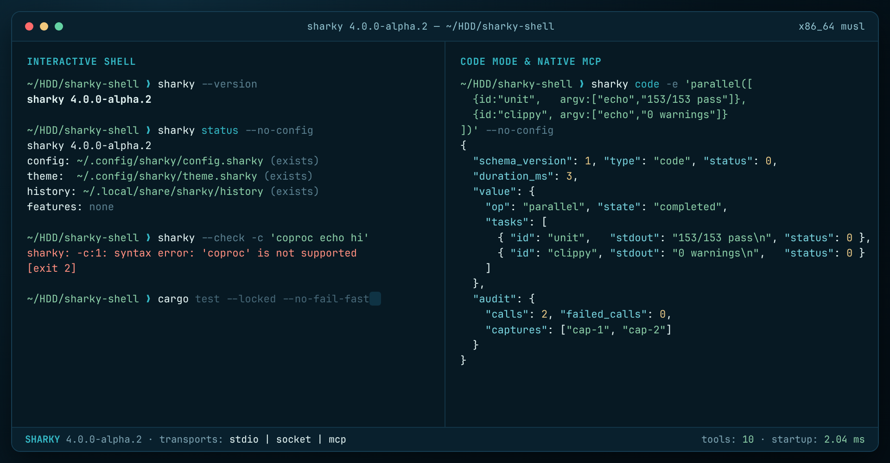
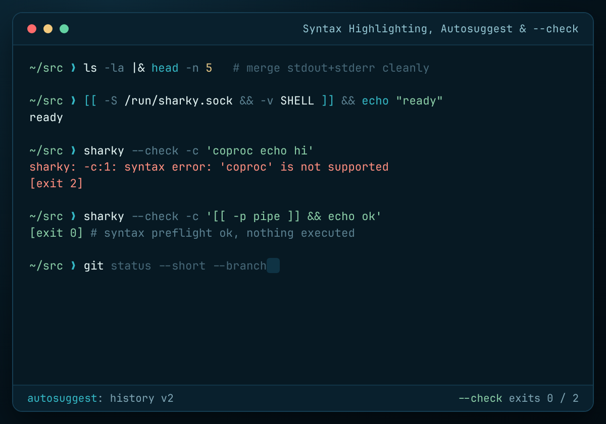
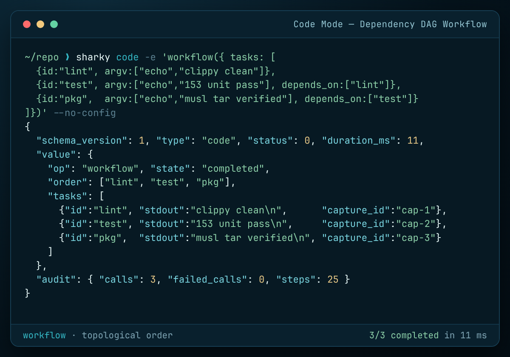
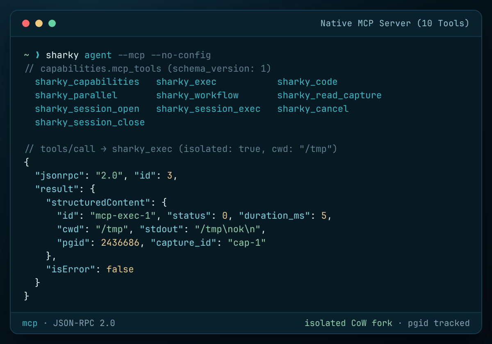
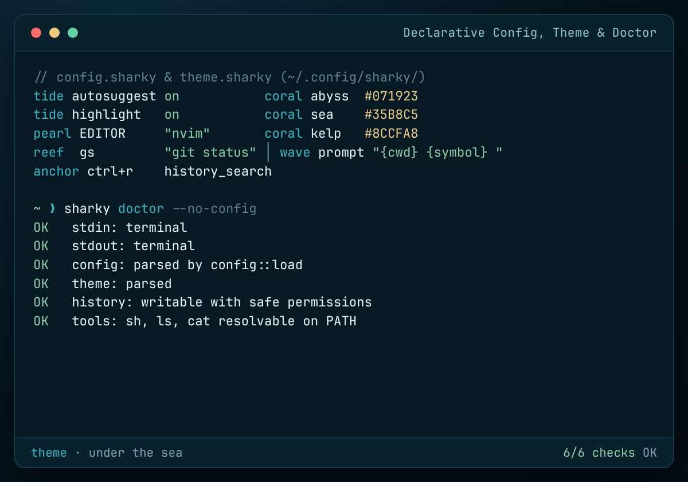

<div align="center">

<picture>
  <source media="(prefers-color-scheme: dark)" srcset="assets/brand/sharky-mark-inverse.svg" />
  
</picture>

<h1>sharky</h1>

<p><strong>Unix-first interactive shell and structured agent runtime written in Rust.</strong></p>

<p>
  Fast cold startup, POSIX-subset script execution, native Code Mode, and an embedded MCP server — shipped as a single static musl binary.
</p>

<p>
  <a href="https://github.com/mafuzyk/sharky-shell/releases"></a>
  <a href="https://github.com/mafuzyk/sharky-shell/actions/workflows/rust.yml"></a>
  <a href="https://aur.archlinux.org/packages/sharky-shell-bin"></a>
  <a href="LICENSE"></a>
</p>



<p><em>Interactive shell with live syntax highlighting, syntax preflight, and native parallel Code Mode (v0.1.0-alpha.1)</em></p>

</div>

---

<h2 align="center">Installation</h2>

```sh
# Arch Linux (prebuilt static binary on AUR)
paru -S sharky-shell-bin

# NixOS / Nix flakes
nix run github:mafuzyk/sharky-shell

# Prebuilt static Linux x86_64 tarball
curl -fsSLO https://github.com/mafuzyk/sharky-shell/releases/latest/download/sharky-x86_64-unknown-linux-musl.tar.gz
tar -xzf sharky-x86_64-unknown-linux-musl.tar.gz
install -Dm755 sharky ~/.local/bin/sharky
```

> [!NOTE]
> `sharky` is currently in `alpha` (`0.1.0-alpha.1`). Use it freely as an interactive shell and structured agent runtime; setting it as a system login shell (`/etc/passwd`) is not recommended during alpha.

<details>
<summary>NixOS module, Home Manager module, AUR git package, and building from source</summary>

### NixOS module

Add the flake input and enable `programs.sharky` (installs the package and registers `sharky` in `environment.shells` without altering `users.users.<name>.shell`):

```nix
{
  inputs.sharky.url = "github:mafuzyk/sharky-shell";

  outputs = { nixpkgs, sharky, ... }: {
    nixosConfigurations.host = nixpkgs.lib.nixosSystem {
      system = "x86_64-linux";
      modules = [
        sharky.nixosModules.default
        { programs.sharky.enable = true; }
      ];
    };
  };
}
```

### Home Manager module

`homeManagerModules.default` installs `sharky` and optionally manages `$XDG_CONFIG_HOME/sharky/{config,theme}.sharky`:

```nix
{
  imports = [ sharky.homeManagerModules.default ];

  programs.sharky = {
    enable = true;
    configFile = ''
      tide greeting off
      tide autosuggest on
      reef gs "git status"
    '';
    themeFile = ''
      coral sea #35B8C5
      wave prompt "{cwd} ❯ "
    '';
  };
}
```

### AUR from source

```sh
paru -S sharky-shell-git
```

### Build from source

Requires Rust >= 1.85 (`edition = 2024`, workspace crate lives in [`rust/`](rust/)):

```sh
cd rust
cargo build --release --locked
install -Dm755 target/release/sharky ~/.local/bin/sharky
install -Dm644 man/sharky.1 ~/.local/share/man/man1/sharky.1
```

See [`rust/PORTING.md`](rust/PORTING.md) and [`rust/RELEASING.md`](rust/RELEASING.md) for maintainer notes.

</details>

---

<h2 align="center">Benches</h2>

### Cold startup & shell loops

Median wall-clock time across 15 isolated `--no-config` / `--norc --noprofile` runs on Linux `x86_64`:

| Benchmark | sharky `4.0.0-alpha.2` | bash | Comparison vs bash | fish | Comparison vs fish |
| --- | ---: | ---: | --- | ---: | --- |
| Cold startup (`-c ""`) | **2.04 ms** | 5.34 ms | **2.61× faster** | 7.39 ms | **3.6× faster** |
| 1,000× `while [ $i -lt 1000 ]` loop | **4.40 ms** | 8.57 ms | **1.95× faster** | 76.94 ms | **17.5× faster** |
| 1,000× function + `local` + `case` calls | **10.49 ms** | 23.15 ms | **2.21× faster** | 141.28 ms | **13.5× faster** |

### Bash-syntax microbenchmarks

| Benchmark | sharky `4.0.0-alpha.2` | bash | Comparison |
| --- | ---: | ---: | --- |
| 1,000× `[[ $i -lt 1000 ]] + ((i++))` | **3.59 ms** | 6.81 ms | **1.90× faster** |
| 200× `$(printf a)` subshells | **203.68 ms** | 241.58 ms | **1.19× faster** |

<details>
<summary>Reproduce benchmarks</summary>

Measured on the same machine comparing `/home/mafu/HDD/sharky-shell/rust/target/release/sharky` (`4.0.0-alpha.2`), `bash`, and `fish` across 15 iterations each using non-interactive minimal startup (`--no-config` for `sharky`/`fish`, `--norc --noprofile` for `bash`).

- **Startup:** `$SH -c ""`
- **POSIX loop:** `i=0; while [ $i -lt 1000 ]; do i=$((i + 1)); done`
- **Extended test + arithmetic (`sharky`/`bash`):** `i=0; while [[ $i -lt 1000 ]]; do ((i++)); done`
- **Functions + locals + `case`:** `f() { local x=$1; case $x in 0) return 0;; *) return 1;; esac; }; i=0; while ...`
- **Command substitutions (`sharky`/`bash`):** `i=0; while [ $i -lt 200 ]; do x=$(printf a); i=$((i + 1)); done`

</details>

---

<h2 align="center">Screenshots</h2>

<div align="center">

<table>
  <tr>
    <td align="center" width="50%">
      
      <br />
      <sub><b>Interactive highlighting, ghost autosuggest &amp; <code>--check</code> preflight</b></sub>
    </td>
    <td align="center" width="50%">
      
      <br />
      <sub><b>Code Mode dependency DAGs with structured <code>audit</code></b></sub>
    </td>
  </tr>
  <tr>
    <td align="center" width="50%">
      
      <br />
      <sub><b>Native JSON-RPC 2.0 MCP server (10 tools)</b></sub>
    </td>
    <td align="center" width="50%">
      
      <br />
      <sub><b>Declarative <code>config.sharky</code>, <code>theme.sharky</code> &amp; <code>doctor</code></b></sub>
    </td>
  </tr>
</table>

</div>

---

## Interactive shell

`sharky` owns its parser, executor, line editor, completion engine, prompt renderer, and shared history without shelling out to external frameworks:

- **Path-validated ghost autosuggestions:** completes tokens chronologically from shared history, skipping entries whose referenced file paths no longer exist.
- **Live syntax highlighting:** commands, builtins, strings, variables, unknown commands (`@error`), and `>` clobbers over existing files (`@overwrite`).
- **Inline completions & directory jumper:** `Tab` / `Shift-Tab` menu (directories only for `cd`/`pushd`, case-insensitive fallback), `Ctrl-T` fuzzy finder, and built-in frecency `z` / `zi`.
- **Vi mode & multi-line editing:** bracketed paste, `set -o vi` (`h/l/0/$/w/b/e/j/k`, `dd/dw/d$/D/cw/C/p/P/u/r`, counts), abbreviations (`shoal`), and custom keybindings (`anchor`).

<details>
<summary>Default keybindings and v2 shared history format</summary>

### Keybindings

| Key | Action |
| --- | --- |
| `Tab` | Complete current token or open inline menu (`Shift-Tab` cycles backwards) |
| `Right` / `End` | Accept full ghost autosuggestion at end of line |
| `Alt-Right` / `Ctrl-Right` / `Alt-F` | Accept one word of ghost autosuggestion |
| `Up` / `Down` | Prefix-filtered history navigation (restores current draft at bottom) |
| `Ctrl-R` | Incremental frecency-ranked reverse history search (`Ctrl-G` cancels) |
| `Ctrl-T` | Fuzzy file finder in working tree |
| `Ctrl-_` | Undo last line edit |

### Shared history (`~/.local/share/sharky/history`)

- Locked append after every command with `stat`-fingerprinted cross-terminal refresh before each primary prompt (`history merge` forces a full reload).
- Origin-guarded history expansion (`!!`, `!n`, `!prefix` only expand commands from the current session, never freshly pulled commands from another terminal).
- Tab-separated single-line **v2** records (`h2 <when-us> <cwd> <npaths> <paths...> <cmd> <hits>`), backward-compatible with legacy v1 lines and bounded on disk by a 262,144-record vacuum independently of `tide history N`.
- `history [--max N] [--reverse] [--show-time] [--null] [--case-sensitive] [--contains|--prefix|--exact] [PATTERN]` and `history delete --exact PATTERN`.

</details>

---

## Agent runtime & MCP

Designed for both humans and coding agents — zero extra wrapper daemon required:

- **Discovery before startup:** `sharky capabilities --json`, `sharky agent guide --json`, `sharky completions list --json`, `sharky help <topic> --json`, and `sharky --check -c ...` (exits `0` silently or `2` on syntax error without running anything).
- **One-shot JSON & Code Mode:** `sharky --json -c 'COMMAND' --no-config` and `sharky code -e 'PROGRAM' --no-config` with native `run([...])`, `sh(cmd, {cwd, env})`, `parallel(...)`, `workflow(...)` DAGs (`depends_on`, `retry`, `condition`, `lock`), `map_parallel(...)`, and full `audit` summaries (`calls`, `failed_calls`, `cancelled_calls`, `first_failure_status`).
- **Persistent sessions & Native MCP:** `sharky agent --stdio`, `sharky agent --socket PATH` (`0600` Unix socket), and `sharky agent --mcp` exposing 10 typed MCP tools: `sharky_capabilities`, `sharky_exec`, `sharky_session_open`, `sharky_session_exec`, `sharky_parallel`, `sharky_workflow`, `sharky_code`, `sharky_read_capture`, `sharky_cancel`, and `sharky_session_close`.
- **Isolation boundaries:** `isolated: true` copy-on-write forks isolate shell interpreter state (CWD, env, variables, functions), not disk writes — request `sandbox: true` or `{ no_network, read_only_root, max_file_bytes, max_procs, cpu_seconds }` when kernel isolation/rlimits are required.

---

## Shell compatibility

One unified grammar shared between interactive prompts, `-c`, and scripts — **unsupported syntax fails with exit status `2`** rather than falling back silently to `/bin/sh`:

| Category | Supported in `sharky` |
| --- | --- |
| **Control flow & functions** | `if`/`elif`/`else`, `for`, `for ((...))`, `while`, `until`, `case` (`;;`, `;;&`, `;&`), functions, `local`, groups `{ ...; }`, subshells `( ... )`, `!` |
| **Tests & arithmetic** | `[ ... ]`, `[[ ... ]]` (`-e/-f/-d/-L/-r/-w/-x/-s/-S/-p/-v/-o`, regex `=~`, pattern `==`, `&&`/`\|\|`), `$((...))` and `((...))` |
| **Expansions & arrays** | `${NAME:-default}`, substrings, case conversion, indirect `${!ref}`, `$(...)`, tilde, extglob, indexed & associative arrays (`declare -a/-A`), `IFS` splitting |
| **Redirections & plumbing** | `>`, `>>`, `>|` (`noclobber`), `<`, `2>&1`, `\|&`, `<&N`/`>&N`/`<&-`/`>&-`, `<(list)`, `>(list)`, heredocs, `<<<` here-strings |
| **Options & job control** | `set -e/-u/-o pipefail/-o vi`, `shopt -s/-u globstar\|autocd`, `trap`, `jobs`, `fg`, `bg`, `wait [-n]`, `kill`, `disown`, `times`, `hash`, `ulimit` |
| **Unsupported (exits `2`)** | `coproc`, namerefs (`declare -n`), `select` loops, loadable builtins |

<details>
<summary>Login mode & diagnostics (`status`, `doctor`, `config explain`)</summary>

- `sharky status [--no-config]` prints version, resolved config/theme/history paths with existence checks, and active compile-time feature flags.
- `sharky doctor [--no-config]` runs read-only checks on stdin/stdout descriptors, config/theme parsing, history permissions, and baseline PATH tools (`sh`, `ls`, `cat`).
- `sharky config explain [TOPIC]` prints builtin documentation for every declarative configuration directive without touching runtime state.
- Login mode (`-l` / `--login`) runs `/etc/sharky/profile.sharky` and `~/.config/sharky/profile.sharky`, and safely imports literal `NAME=value` / `export NAME=value` lines from `/etc/profile`, `~/.profile`, `~/.bash_profile`, and `~/.zshprofile`.

</details>

---

## Configuration & theming

Declarative configuration in `$SHARKY_CONFIG` (defaults to `~/.config/sharky/`) with one statement per line, `//` comments, and double-quoted strings:

```sh
// ~/.config/sharky/config.sharky
tide greeting off
tide autosuggest on
tide highlight on
tide history 10000

pearl EDITOR "nvim"
current "~/.local/bin"

shoal gco "git checkout"
reef gs "git status"
anchor ctrl+r history_search
anchor tab complete
```

```sh
// ~/.config/sharky/theme.sharky
coral abyss  #071923
coral foam   #E4F5F4
coral sea    #35B8C5
coral kelp   #8CCFA8
coral danger #FF8F80

wave prompt "{cwd_short} {git}{symbol} "
wave prompt.cwd @kelp
wave prompt.symbol @sea
```

<details>
<summary>All declarative directives and prompt tokens</summary>

- **`config.sharky`**:
  - `tide <key> <value>` — `greeting`, `autosuggest`, `autocd`, `highlight`, `starship`, `rprompt`, `profile_paths` (`on`/`off`), `prompt` (`native`/`starship`/`omp`), `omp_config` (Oh My Posh theme path), `history` (integer)
  - `pearl NAME "value"` — export an environment variable
  - `current "/dir"` — prepend to `PATH`
  - `reef name "command"` — alias
  - `shoal name "expansion"` — command-position abbreviation (expands on space/Enter)
  - `anchor <key> <action>` — bind `ctrl+x`/`alt+x`/`tab`/`shift-tab`/`home`/`end` to `accept_line`, `abort`, `backward_char`, `forward_char`, `backward_word`, `forward_word`, `kill_line`, `yank`, `undo`, `history_search`, `complete`, `accept_suggestion`, or `fuzzy_files`
- **`theme.sharky`**:
  - `wave preset <name>` — built-in zero-cost presets: `sharky`, `neolambda`, `pure`, `robbyrussell`, `powerline` (run `sharky config explain presets`)
  - `coral <name> #RRGGBB` — define colour token
  - `wave <key> <style | template>` — configure `prompt` and `rprompt` (`\uXXXX` escapes, `{cwd}`, `{cwd_short}`, `{cwd_full}`, `{cwd_home}`, `{git}`, `{git_dirty}`, `{duration}`, `{duration_ms}`, `{symbol}`, `{status}`, `{error_status}`, `{user}`, `{host}`, `{os_icon}`, `{shell}`, `{mem}`, `{venv}`, `{nix}`, `{ssh}`, `{jobs}`, `{time}`, `{fill}`, conditional `[...]` groups, inline `{style:text}` spans, `prompt.symbol.glyph`, `prompt.os.glyph`), rich styles (`@token`, `#RRGGBB`, `on @bg`, `bold`/`dim`/`italic`/`underline`/`reverse`), syntax styles (`command`, `builtin`, `string`, `variable`, `error`, `overwrite`), and UI accents (`prompt.*`, `suggestion`, `selection`). Set `NO_COLOR=1` for monochrome prompts.

</details>

---

## Docs & development

- [`CHANGELOG.md`](CHANGELOG.md) — release history across 4.x and 3.x milestones
- [`docs/roadmap-status.md`](docs/roadmap-status.md) — active roadmap and implemented phases
- [`docs/agent-runtime-mvp-design.md`](docs/agent-runtime-mvp-design.md) — session protocol (`--stdio` / `--socket` / `--mcp`)
- [`docs/parallel-executor-design.md`](docs/parallel-executor-design.md) — CoW parallel task worker specification
- [`docs/workflow-executor-design.md`](docs/workflow-executor-design.md) — DAG workflow retries, conditions, and flock locks
- [`docs/code-mode-design.md`](docs/code-mode-design.md) — embedded programmatic orchestration runtime
- [`rust/PORTING.md`](rust/PORTING.md) & [`rust/RELEASING.md`](rust/RELEASING.md) — building, testing, and releasing

Differential behavioral tests compare against a local `.ruby-oracle/` checkout of frozen tag `v1-ruby` when present (`SHARKY_REF=/nonexistent/sharky` runs core tests standalone). Run `cargo test --locked --no-fail-fast` and `cargo clippy --locked --all-targets -- -D warnings` inside `rust/` before tagging.

---

## License

Released under the [GNU General Public License v3.0 only](LICENSE) (`GPL-3.0-only`).
